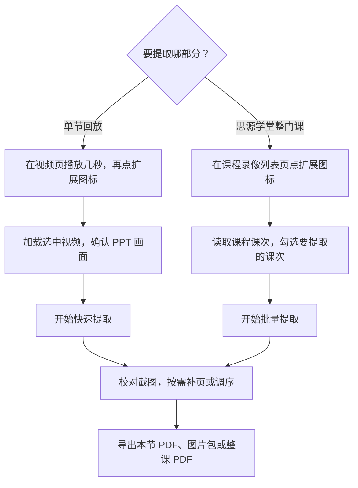

**不发 PPT？那我就自己爬！**

把西安交通大学思源学堂课程录播里的幻灯片自动截下来，去重整理后导出成 PDF 或图片包。思源学堂支持整课批量提取，其他直录播平台支持从单节回放提取。

当前版本：**3.2.0** · [下载扩展](https://github.com/MeowSaint/XJTU-PPT-Capture-Extension/releases/latest/download/ppt-capture.zip) · [版本记录](https://github.com/MeowSaint/XJTU-PPT-Capture-Extension/releases)

> [!WARNING]
> **仅供学习复习，请尊重老师的劳动。**
>
> 请使用本人账号登录思源学堂，只整理自己选修或有权观看的课程。课程视频与课件归授课教师及相关权利人所有，**提取出的课件、截图和 PDF 严禁用于商业用途**。项目代码按 [MIT 许可证](LICENSE) 开源。

## 支持的浏览器

支持 **Windows、macOS 和 Linux** 上的桌面版 Chrome（114+）、Edge 和 Brave，点击下方图标或名称可前往官方下载页。

|  |  |  |
| :---: | :---: | :---: |
| [Google Chrome](https://www.google.com/chrome/) | [Microsoft Edge](https://explore.microsoft.com/edge/download) | [Brave](https://brave.com/download/) |
| 推荐首选 | Windows 自带，macOS / Linux 也能装 | 平时用 Brave 可直接使用 |

## 安装与更新

1. 下载上方的扩展包，解压到固定文件夹，保留该文件夹供浏览器读取。
2. 打开扩展管理页。Chrome 用 `chrome://extensions`，Edge 用 `edge://extensions`，Brave 用 `brave://extensions`。
3. 开启**开发者模式**，点击**加载已解压的扩展程序**，选择含 `manifest.json` 的文件夹。把扩展图标固定到工具栏，方便在视频页打开。

更新时，先关闭工具页，用新版文件覆盖原文件夹，再到扩展管理页点**重新加载**并刷新课程页。

## 快速上手

### 提取单节回放

1. 在视频页播放几秒后点击扩展图标。在「视频」页签选择来源，点**加载选中视频**。列表为空时点**刷新视频列表**，提示需要权限时点**授权并检测**。已有视频文件可直接从**本地视频**导入。
2. 检查预览。思源学堂优先选文件名以 `2-` 开头的 PPT 画面。只有 `0-` 教室机位时，点**框选 PPT 区域**，拖出投影幕的范围。
3. 点**开始快速提取**，保持工具页打开。默认每 2 秒比较一次画面，发现变化后每 0.5 秒细查，确认翻页后才保存。已保存的课次沿用原采样设置。

### 批量提取思源学堂整门课

在课程的**录像列表页**点扩展图标，展开**批量课次**，点**读取课程课次**。核对列表并勾选所需课次，再点**开始批量提取**。若某节只有教室机位，点该行的**加载 0 路并框选**。其他直录播平台可按上面的单节流程提取当前回放。

### 校对与导出

- **补漏页**。点截图的时间戳可回看原视频。在「待复核时间段」点**细查此段**，或把视频拖到漏掉的幻灯片，点**保存当前页**。
- **整理页序**。拖动缩略图可调序，点**清理相似页**可逐对比较。想保留原图但在讲义中跳过某页，可将其排除，导出时将「导出范围」切到**学习版**。
- **导出本节或整课**。点**本节 PDF** 或**本节图片包**导出整节，勾选缩略图可单独导出所选页。在**导出设置**中可切换原比例单页或带笔记线的 A4 讲义。整课可选带课次目录的**合并整课 PDF**，或每节一个文件的**分课 PDF 包**。

## 常见问题

**找不到视频怎么办？** 回来源页播放几秒，再刷新视频列表。快速提取支持 MP4、WebM 和未加密的点播 HLS，有直链可填入**手动视频地址**。如果视频能播放但找不到地址，可在「视频」页签展开「备用方式：实时共享画面」，点**选择共享画面**并选中课程标签页，再点**开始实时截取**。截取期间请保持视频播放。

**漏页或重复页多怎么办？** 短暂翻页容易漏掉，可把采样模式改为**细查 · 每 0.5 秒**。若画中画或角标频繁变化，可用**框选忽略区**排除干扰。忽略区只影响翻页判断，导出时仍会保留这部分画面。

**中断后怎么继续？** 在**本机课次**中选回该节。在线视频点**加载本节原视频**，本地文件点**重新选择本地原视频**，载入后点**继续提取**。在线地址失效时，回来源页重新获取。截图和进度保存在当前浏览器，卸载扩展或清除其数据前请先导出。

**为什么加载较慢？** 在线 MP4 和 WebM 需先缓存到本机磁盘，以便快速跳转，HLS 按分片读取。空间不足时可清理磁盘，或下载视频后从本地导入。画面比对和导出都在本机完成。

**PDF 里的文字能搜索吗？** 导出的是幻灯片截图，没有 OCR 文字层。

## 开发与许可

源码无需构建，可直接加载仓库根目录。测试需要 Node.js 20+，安装依赖后运行 `npm test`。在根目录运行 `npm run release` 即可生成 `ppt-capture.zip`。[测试说明](tests/README.md)

项目代码采用 [MIT 许可证](LICENSE)。随附组件见[第三方声明](THIRD_PARTY_NOTICES.md)。
