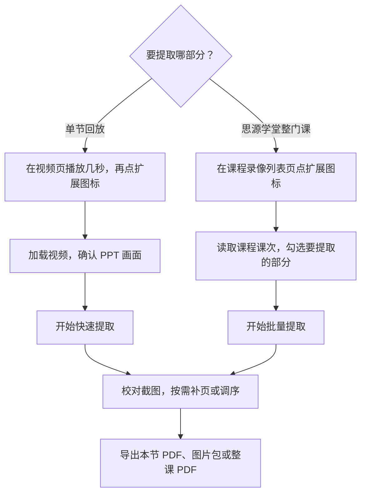

**不发 PPT？那我就自己爬！**

把课程录播里的幻灯片自动截下来，去重整理后导出成 PDF 或图片包。西安交通大学思源学堂能提取单节回放，也能批量提取整门课；其他网站的网页视频、本地视频文件和实时共享的画面同样可以提取。

当前版本：**3.2.2** · [下载扩展](https://github.com/MeowSaint/XJTU-PPT-Capture-Extension/releases/latest) · [版本记录](https://github.com/MeowSaint/XJTU-PPT-Capture-Extension/releases)

> [!WARNING]
> **仅供学习复习，请尊重老师的劳动。**
>
> 请用本人账号登录思源学堂，只整理自己选修或有权观看的课程。课程视频与课件归授课教师及相关权利人所有，**提取出的课件、截图和 PDF 严禁用于商业用途**。项目代码按 [MIT 许可证](LICENSE) 开源。

## 支持的浏览器

支持 **Windows、macOS 和 Linux** 上的桌面版 Chrome（114+）、Edge 和 Brave，点击下方图标或名称可前往官方下载页。

|  |  |  |
| :---: | :---: | :---: |
| [Google Chrome](https://www.google.com/chrome/) | [Microsoft Edge](https://explore.microsoft.com/edge/download) | [Brave](https://brave.com/download/) |
| 推荐首选 | Windows 自带，macOS / Linux 也能装 | 平时用 Brave 可直接使用 |

## 安装与更新

1. 到[最新 Release 页面](https://github.com/MeowSaint/XJTU-PPT-Capture-Extension/releases/latest)下载 `ppt-capture.zip`，解压到固定文件夹，保留该文件夹供浏览器读取。
2. 打开扩展管理页。Chrome 用 `chrome://extensions`，Edge 用 `edge://extensions`，Brave 用 `brave://extensions`。
3. 开启**开发者模式**，点**加载已解压的扩展程序**，选择含 `manifest.json` 的文件夹。把扩展图标固定到工具栏，方便在视频页打开。第一次打开工具页要先同意**课程资料使用约定**。

更新时，先关掉工具页，用新版文件覆盖原文件夹，再到扩展管理页点**重新加载**，然后刷新课程页。

## 快速上手

工具页已经开着时，再点扩展图标只会把它切到最前，并把来源换成当前视频页，不会再开第二个工具页；正在提取时点图标只切到最前，不打断当前课次。

### 提取单节回放

1. 在视频页播放几秒后点扩展图标。工具页打开后会自己找视频，也可以点**刷新列表**重新扫描。在「视频」页签选中来源，点**加载视频**。有地址待授权时点**授权并检测**，读不到来源页内容时点**授权来源页**。手上已有视频文件，直接从**本地视频**导入。
2. 检查预览。思源学堂里文件名以 `2-` 开头的通常是 PPT 机位，优先选它；只有 `0-` 教室机位时，点**框选 PPT 区域**拖出投影幕范围，PPT 占满画面时点**使用完整画面**即可。
3. 点**开始快速提取**，保持工具页打开。默认每 2 秒比较一次画面，发现变化后每 0.5 秒细查，确认翻页才保存。同一课次再次打开会沿用上次的采样设置。

### 批量提取思源学堂整门课

在课程的**录像列表页**点扩展图标，扩展会自己读取全部课次并展开**批量课次**。也可以手动展开**批量课次**，点**读取课程课次**。核对列表、勾选要提取的课次，点**开始批量提取**。读取失败的课次可以点**重试失败课次**再读一遍。某节只有教室机位时，点该行的**加载 0 路并框选**，先在预览里框出 PPT 区域。

### 校对与导出

- **补漏页**。点截图的时间戳可以回看原视频。画面转换不稳的时段会列在**待复核时间段**里，点**细查此段**只重扫这一段；也可以把视频拖到漏掉的那页，点**保存当前页**。
- **整理页序**。拖动缩略图调整顺序，点**清理相似页**逐对比较相邻页面。点**整理建议**会按画面和时间线索列出可疑页，勾选并确认后才排除，工具不会自己删页。
- **挑学习版要用的页**。**导出范围**默认是**原始保留页**，导出全部截图；把多余的页排除后切到**学习版**，就只导出剩下的页。用**显示**筛出**已排除页**能回看排除结果，点**恢复所选**可以放回来。把**本节复核**标成**无独立内容（跳过）**时，学习版在这一节不导出任何页。
- **导出本节或整课**。点**本节 PDF**、**本节图片包**导出整节；勾选缩略图后，**所选 PDF**、**所选图片包**只导出选中的页。点**导出设置**跳到「导出」页签，可以切换原比例单页或带笔记线的 A4 讲义，也可以打开标注视频时间和生成页码书签。整课可导出带课次书签的**合并整课 PDF**、每节一个 PDF 的**分课 PDF 包**，以及记录每节扫描进度和待复核时间段的**课程完整性报告**（JSON）。

## 常见问题

**找不到视频怎么办？** 回来源页播放几秒，再点**刷新列表**。快速提取支持 MP4、WebM 和未加密的点播 HLS，有直链就填进**手动视频地址**。视频能播但抓不到地址时，在「视频」页签展开**实时共享画面**，点**选择共享画面**选中课程标签页，再点底栏的**开始实时截取**；画面稳定 1.5 秒记为新页，这个时长可以改，截取期间保持视频播放。

**漏页或重复页多怎么办？** 短暂翻页容易漏，把采样模式改成**细查 · 每 0.5 秒**。画中画、角标频繁变化时，用**框选忽略区**把它们排除。忽略区只影响翻页和相似页判断，导出时仍保留完整画面。

**中断后怎么继续？** 在**本机课次**里选回那一节。在线视频点**加载本节原视频**，本地文件点**重新选择本地原视频**，载入后底栏的**开始快速提取**会变成**继续提取 · 断点时间**，点它从断点接着扫。在线地址失效就回来源页重新取一次。截图和进度存在当前浏览器里，卸载扩展或清理扩展数据前先导出。课次可以在**管理本机课次**里删除，删除不可撤销，会一起删掉截图、课次设置和关联批量任务；视频缓存要另外点**释放视频缓存**清理。

**为什么加载较慢？** 在线 MP4 和 WebM 要先缓存到本机磁盘，才能快速跳转，HLS 按分片读取。空间不足时清一下磁盘，或者下载视频后从本地导入。画面比对和导出都在本机完成。

**PDF 里的文字能搜索吗？** 导出的是幻灯片截图，没有 OCR 文字层。

## 开发与许可

源码不用构建，把仓库根目录直接当作扩展加载。根目录放 `manifest.json`、`capture.html` 和 `style.css`，扩展脚本在 `src/`，第三方库在 `vendor/`，打包脚本在 `scripts/`。测试需要 Node.js 20+，安装依赖后运行 `npm test`，细节见[测试说明](tests/README.md)。在根目录运行 `npm run release` 生成 `ppt-capture.zip`。

项目代码采用 [MIT 许可证](LICENSE)。随附组件见[第三方声明](THIRD_PARTY_NOTICES.md)。
